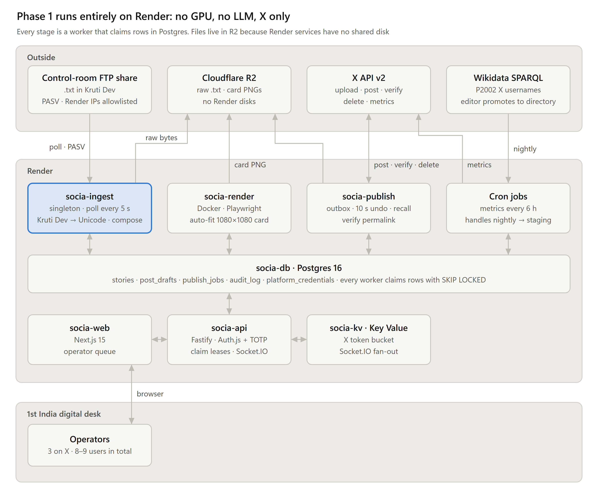
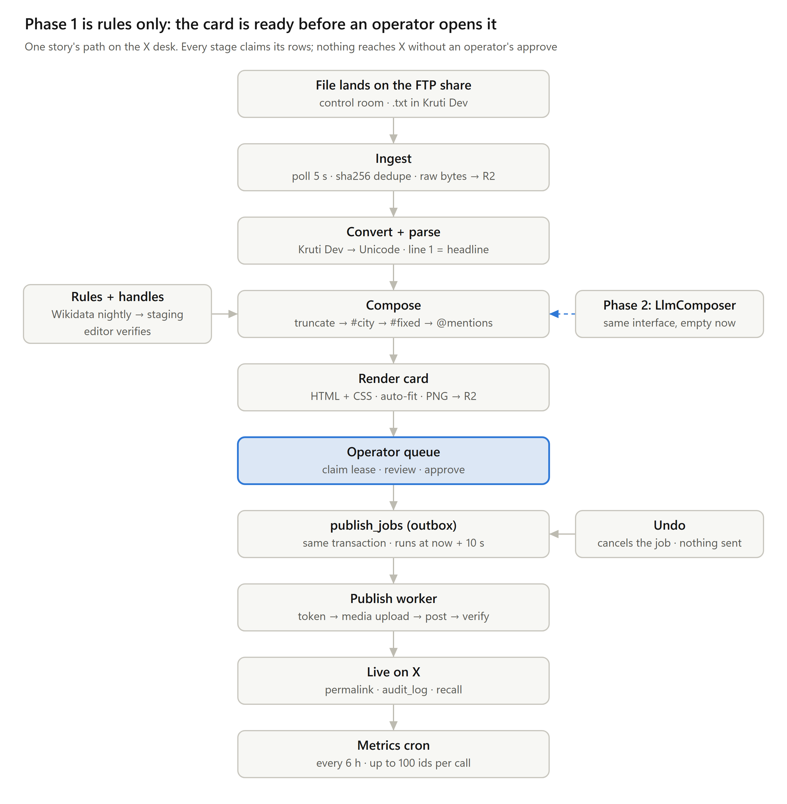
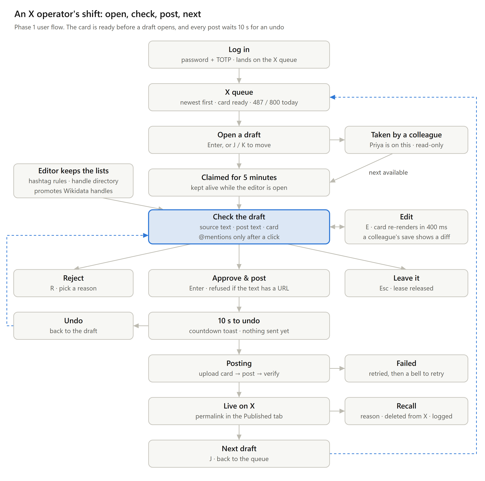

# backend-socia

The backend for **Socia**, 1st India News' digital desk. It takes the stories the assignment desk approved in **Samvadia**, with their footage from the newsroom FTP, and turns them into X posts. Each post gets a rendered card and needs one operator click to go out. (The older path, Kruti Dev text files from the FTP share or a folder, still works with `SOURCE_MODE=folder|ftp`.)

Phase 1 is **deterministic only**: no LLM, no GPU, no image-generation API. It covers X only; Instagram, Facebook and video come later. It is built from *Socia — Phase 1 Backend Architecture v1.0* (17 Oct 2026), and the *Socia spec v1.1* remains the long-term contract.



## How a story moves



| Stage | What happens | Where |
|---|---|---|
| Ingest (Samvadia) | `SOURCE_MODE=samvadia`. Every 5 s, reads stories Samvadia put in its feed (`stories.state='ready'`, originals and updates; not kills) since a stored cursor, through a read-only session. Each becomes a story here once, deduped by Samvadia story id + version, already Unicode, so it skips conversion. Footage: lists `items.footage_path` on the FTP (read only: list and download, nothing else), copies photos within `MEDIA_TYPES`/`MEDIA_MAX_MB`, records videos (copies them when `MEDIA_VIDEO=true`). Late footage still attaches for 30 h | `apps/worker/src/stages/samvadia.ts`, `packages/db/src/samvadia.ts`, `packages/providers/src/footage.ts` |
| Ingest (files) | `SOURCE_MODE=folder\|ftp`. Polls the share every 5 s. A file is taken once two scans 2 s apart see the same size. The sha256 dedupes re-saves, and the raw bytes are kept in storage | `apps/worker/src/stages/ingest.ts` |
| Convert + parse | Files only: Kruti Dev → Unicode, then line 1 is the headline and the rest is the body, with a confidence score | `packages/core/src/kruti.ts`, `parse.ts` |
| Pair | Text and media share a slug. Either can arrive first, a story waits up to 6 h for media, and late media still attaches | `packages/db/src/pipeline.ts` |
| Compose | Pure rules, First India's format: `#District: <headline>`, a blank line, the opening of the body cut on a word with `....`, a blank line, then the org's fixed tags and topic tags (or `#FirstIndiaNews` when neither). The whole post stays within X's weighted 280; the body is cut first, the headline last. @mentions are suggestions only | `packages/core/src/compose.ts` |
| Render | HTML card, auto-fit by binary search in Chromium, PNG to storage. Runs before anyone opens the draft | `apps/worker/src/card/`, `stages/render.ts` |
| Operator | Claims a 5-minute lease, edits (a stale version gets 409), then approves, rejects or leaves | `packages/db/src/desk.ts`, `apps/api/src/routes/desk.ts` |
| Outbox | Approve writes the publish job in the same transaction, set to run 10 s later. Undo cancels it if no worker has taken it yet | `desk.ts` `approveDraft`, `undoPost` |
| Publish | Takes a rate token, gets the card, uploads media, creates the post, records the id, verifies, then marks success. Retries with backoff and gives up after 5 attempts | `apps/worker/src/stages/publish.ts`, `packages/db/src/queue.ts` |
| Recall | Recall deletes on X and is logged with its reason. Post numbers are not tracked here (the digital dashboard covers them) | `stages/publish.ts` |

What an operator does in a shift:



## Layout

```
apps/api          Fastify API + Socket.IO. Writes rows only: never calls X, never renders.
apps/worker       One binary, roles chosen per Render service: ingest, pipeline, render, publish,
                  maintenance, trends, and the handles cron.
packages/core     Every pure function: Kruti Dev, parse, slug, compose, hashtags, mentions,
                  states, caps, card fit, TOTP. Unit tested; the API uses it for live checks.
packages/db       Drizzle schema + migrations, desk operations (claim, approve, undo, recall),
                  the publish outbox, live events (pg_notify), audit log.
packages/providers  Storage (R2 / local), the FTP or folder source, the X client, Wikidata.
```

## Run it locally

You need Node 22+, pnpm 10 (`corepack pnpm` works without installing it) and Postgres 16+. Everything runs on this machine with dummy data: a dummy Samvadia database, a folder that stands in for the FTP, and fake X.

```bash
corepack pnpm install
corepack pnpm --filter @socia/worker exec playwright install chromium
# .env: copy .env.example and fill DATABASE_URL + SECRET_KEY, or keep the one already written for this PC.
# Local values: PORT=8200, CORS_ORIGINS=http://localhost:3005, REQUIRE_TOTP=false, X_MODE=fake,
# SOURCE_MODE=samvadia, FOOTAGE_DIR=./.local/ftp-dummy, STORAGE_DIR=./.local/store
corepack pnpm local:migrate
# Dummy Samvadia (socia_samvadia_dummy) + dummy FTP tree; needs the local superuser URL in the shell only:
ADMIN_DATABASE_URL=postgresql://postgres:<pw>@localhost:5432/postgres corepack pnpm local:dev samvadia-seed
corepack pnpm local:dev socia-setup          # org, admin + operator logins -> local.credentials.md (gitignored)
corepack pnpm local:api                      # API + Socket.IO on :8200
corepack pnpm local:worker                   # ingest, pipeline, render, publish, maintenance
corepack pnpm local:dev samvadia-late        # later: late footage + one newly approved story
```

Within a few seconds the ~30 approved dummy stories are ready drafts with cards and their footage. With `X_MODE=fake`, posting only records a fake id and nothing reaches X. The seed refuses anything not on localhost and Samvadia's own databases (`samvadia`, `samvadia_preview`).

For the older file path: `SOURCE_MODE=folder`, drop a `.txt` file into `SOURCE_DIR`.

### Tests

```bash
pnpm test                       # unit tests always run (or: corepack pnpm -r --workspace-concurrency=1 test)
TEST_DATABASE_URL=postgresql://... pnpm test   # integration tests too; that database is wiped
```

The integration tests run on real Postgres and real Chromium. They cover:

- claim leases: one operator per draft, and the 409 on a stale save
- the 10 s undo, and refusing undo once a worker has taken the job
- daily caps
- retries, dead jobs, and rate limits that do not use up an attempt
- reconciliation after a worker crash, so nothing posts twice
- recall
- events sent only when the change commits
- the full path from a Kruti Dev file in a folder to a post on the fake X client
- the Samvadia source: read-only session, originals/updates but not kills, dedupe by story id + version, the
  cursor and its overlap window, footage photos-first with type/size/video rules, late footage, and on to a fake post
- the FTP is read only: only list/download reach the client, and no write call appears on the Samvadia path
- the dashboard reads: counts, ingest status, media on a draft, cards on posts
- sign-in with TOTP, and CSRF
- role limits
- a live Socket.IO event

## How the digital desk calls it

Every request sends cookies (`credentials: "include"`). Every POST, PATCH and DELETE also sends `X-CSRF: <csrfToken from /auth/login or /me>`.

| Screen | Calls |
|---|---|
| Sign in | `POST /auth/login {email, password}` → `next`: `totp` or `totp_setup` · `POST /auth/totp {code}` · `POST /auth/totp/setup` → QR URI, then `POST /auth/totp/enable {code}` · `GET /me` · `POST /auth/logout` |
| X queue | `GET /x/queue?view=inbox\|sending\|rejected\|failed&before=` (each item has its card URL, the claim holder, and flags) · `GET /caps` |
| Draft | `GET /drafts/:id` · `POST /drafts/:id/claim` (409 names who holds it) · `POST /drafts/:id/heartbeat` every 60 s · `POST /drafts/:id/release` |
| Edit | `PATCH /drafts/:id {version, bodyText?, cardHeadline?, hashtags?, mentions?}` (409 on a stale version, with the current copy) · `POST /x/check` for the live counter |
| Decide | `POST /drafts/:id/approve {version}` → `{jobId, sendAt}` · `POST /jobs/:id/undo` · `POST /drafts/:id/reject {reason, note?}` · `POST /drafts/:id/restore` · `POST /drafts/:id/retry` |
| Published | `GET /posts?before=` (with card) · `POST /posts/:id/recall {reason}` |
| Dashboard | `GET /x/counts` (per state and view, posts today, cap) · `GET /ingest/status` (last poll, errors, cursor, today's intake) |
| Library | `GET/POST/PATCH/DELETE /hashtag-rules` · `GET /handles?q=` (the @ picker) · `POST/PATCH/DELETE /handles` · `GET /handles/staging` · `POST /handles/staging/:id/promote` · `.../dismiss` |
| Admin | `GET/POST/PATCH /users` · `GET /audit?entityType=&entityId=` |
| Live | `io(API, { withCredentials: true })`. Events: `story.arrived`, `draft.updated`, `draft.claimed`, `draft.released`, `post.queued`, `post.cancelled`, `post.sent`, `post.failed`, `post.recalled`, `cap.changed`, `media.attached`, `ingest.status`, and `resync` (refetch everything) |

The full contract, with request and response shapes and error codes, is in `C:\vartmaan\code\handoff\socia-api-contract.md` (outside this repo).

Reject reasons are `inaccurate`, `duplicate`, `low_quality`, `policy` and `other`. Roles work like this:

- **Operator:** acts on their own platforms, and posts directly.
- **Editor:** acts on any platform, and also maintains hashtag rules and handles.
- **Admin:** everything an editor can do, plus users.
- **Viewer:** read only.

## Go live

Only `.env` changes; `.env.live.example` lists exactly which lines.

1. **Samvadia:** point `SAMVADIA_DATABASE_URL` at the real Samvadia database with a SELECT-only login (the SQL to create it is in `.env.live.example`). Socia also opens every session and transaction read-only.
2. **FTP:** remove `FOOTAGE_DIR` and set `FTP_HOST=<newsroom-ftp-host>`, `FTP_USER`, `FTP_PASSWORD`. Socia only lists and downloads; a read-only FTP account is best.
3. **X:** `X_MODE=api` plus the four OAuth 1.0a keys. Confirm limits against X's current docs first (see below).
4. **Sign-in:** `REQUIRE_TOTP=true`. Every user sets up an authenticator app on first login.
5. Restart the API and the worker. On the first start the Samvadia cursor reaches back `SAMVADIA_BACKFILL_HOURS` (default 24; `0` starts from now). Watch `GET /ingest/status`.

Not needed for go-live: `local.credentials.md`, `samvadia-seed`, `samvadia-late` and the dummy folders are local tools only.

## Deploy on Render

`render.yaml` creates every service in the doc's topology:

| Service | Type | Notes |
|---|---|---|
| `socia-api` | Web Service | Runs migrations before each deploy |
| `socia-ingest` | Background Worker | Singleton; also runs convert and compose |
| `socia-render` | Background Worker | Docker, on the Playwright image |
| `socia-publish` | Background Worker | Also runs housekeeping |
| `socia-cron-handles` | Cron Job | 02:00 IST |
| `socia-db` | Postgres | |
| `socia-kv` | Key Value | X token bucket |

Fill in the `sync: false` values when Render asks. Render has no persistent disks, so every file lives in R2. Workers finish their current job on SIGTERM, and leases expire on their own, so a deploy mid-job is safe.

To reach the control-room FTP: use passive mode, pin Render's static outbound IPs, and have 1st India's IT allowlist them.

## Where this differs from the architecture doc

- **Login.** Login is password + TOTP inside Fastify, with sessions in Postgres, not Auth.js. The frontend is a separate app, and Auth.js is built to live inside Next.js.
- **Live updates.** Live updates go through `pg_notify` from the same transaction as the change. Each API instance listens and pushes to its own sockets, so an event is never sent for a change that rolled back. Redis is used only for the X token bucket.
- **Ellipsis.** The ellipsis is added only when the text was actually cut. The doc's sample code always adds it.

## Not settled yet

- **Kruti Dev table: provisional.** It is built from the common Kruti Dev 010 layout, not from the control room's own `.ttf`. Get the exact font and 200 real files, build the 30-file regression set, and reach ≥99% character accuracy before trusting anything downstream (doc §12 Q1).
- **X API: confirm against live docs.** Check the v2 media upload and `POST /2/tweets` with OAuth 1.0a before switching to `X_MODE=api`. Check current rate limits too, and set `X_RATE_TOKENS` / `X_RATE_WINDOW_SECONDS` to match. The doc warns that X has changed this surface repeatedly.
- **Card template: placeholder.** It needs the client's template, logo and licensed font, plus a visual sign-off on sample cards.
- **Hashtag script.** City tags can come out as `#जयपुर` or `#Jaipur` (the org setting `hashtagScript`); the desk still has to choose (doc §12 Q3).
- **Hindi input.** Find out whether operators type Unicode or on the Remington layout. That decides the editor in the frontend, not the backend.
